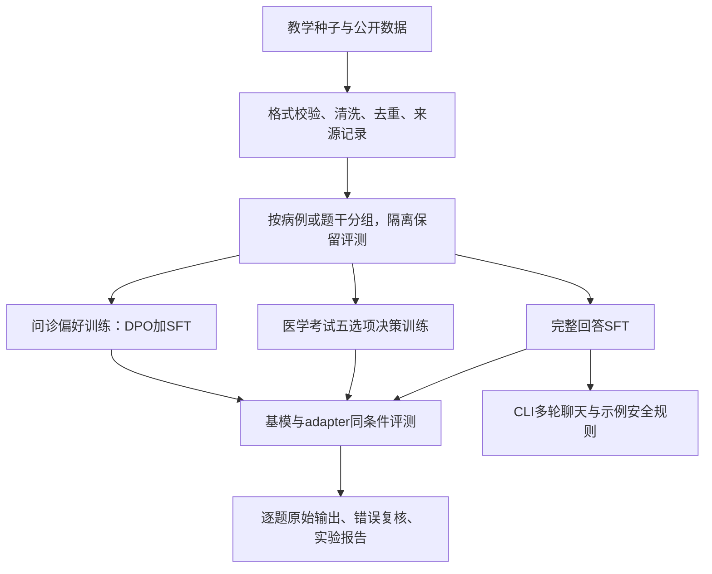

# 项目总结、简历写法与面试准备

根据截至2026-11-06的代码、训练记录和评测产物整理。简历建议名称：**基于Qwen2.5-7B的医疗领域微调与评测系统**。

## 1. 项目定位与当前完成度

这是在单张RTX 3090 24GB上，围绕医疗健康咨询搭建的领域适配实验工程。覆盖数据下载、清洗、分组划分、QLoRA训练、adapter加载、命令行多轮聊天、评测对照、错误复核与实验记录。

问诊任务包括医学知识问答、症状采集、分诊、检查选择、报告解读和拒答边界。进一步将“医学考试选项判断”和“自然语言问诊”分别训练、分别评价。

最明确的成果是CMExam固定1000题的受限A–E选项准确率从74.4%升到81.0%，提高6.6个百分点。问诊整体优于基模的目标尚未达到。V5.1的32段留出对话，隐藏模型身份的工程复核结果为微调较好4段、基模较好4段、相当24段，未替换默认问诊模型。

已完成本地实验和CLI演示。FastAPI、网页界面、RAG、真实医生审核流程、生产部署均未完成，不能作为已实现功能写入简历。

## 2. 技术栈与系统结构

Python 3.11、PyTorch、Transformers、PEFT、Accelerate、bitsandbytes、Datasets/PyArrow、TensorBoard、YAML；Windows/Anaconda，RTX 3090 24GB。基模为固定版本的Qwen2.5-7B-Instruct。

| 模块 | 已实现内容 | 主要代码 |
| --- | --- | --- |
| 命令入口 | check、download、generate-data、build-data、train、chat、evaluate、compare等 | `medft/__main__.py` |
| 数据处理 | JSONL messages、基础正则脱敏、去重、病例关联分组、固定数量划分、哈希 | `medft/data.py`、`medft/corpus.py` |
| 公开源治理 | 主题筛选、质量剔除清单、来源行号与哈希、下载错误链和HTTP续传 | `medft/public_filter.py`、`medft/downloads.py` |
| 通用训练 | 聊天模板、assistant-only监督、QLoRA、验证选最优、早停和恢复 | `medft/formatting.py`、`medft/training.py` |
| 推理与规则 | adapter加载、会话历史、reset/quit、输入风险规则及输出复核 | `medft/inference.py`、`medft/safety.py` |
| 专项训练 | 下一token的五选项交叉熵、缓存参考概率的DPO加SFT | `scripts/train_cmexam_choices.py`、`scripts/train_consultation_hard_preferences.py` |
| 实验评测 | 同条件核对、选项换序、配对统计、原文复核、隐藏身份评分 | `scripts/evaluate_cmexam.py`、`scripts/evaluate_consultation.py`等 |

基础正则脱敏只覆盖手机号、18位身份证号和邮箱，不能描述为全面医疗隐私脱敏。安全模块是演示规则，“人工复核”目前只是标记，不是已接通的医生工作台。

## 3. 迭代路线

| 阶段 | 主要工作 | 得到的认识 |
| --- | --- | --- |
| V1流程验证 | 50条教学数据，训练、adapter保存和重新加载 | 先验证工程能跑通，5步试跑不代表有效微调 |
| V1规模复现 | 6000条，5600训练加400验证；本项目345条种子、170个主题/场景组 | 行数不能替代独立病例和知识覆盖，12题关键词全中仍可能有事实错误 |
| V2/V2.1 | 扩展六类任务与多轮、单位、趋势、假设风险；早停和最佳权重核验 | 部分任务改善，其他任务退化；不能靠总分掩盖危险建议 |
| V3系列 | 数据质量对照、完整答案、基模回答回放、学习率与LoRA范围调整 | 验证loss降低与问诊质量提高并不等价，多组生成结果仍退化 |
| V4.1/V4.2 | 公开CMExam数据；从完整解析SFT转向五选项决策训练 | 获得明确的选项判断收益，但未同步获得问诊收益 |
| V5/V5.1 | 184组偏好对照扩至220组；强化事实状态和关键行动 | 开发规则分数略变，最终内容比较仍未证明整体提升 |

各阶段数据互有继承和重写，不能把所有版本的行数相加，当成独立训练数据总量。

## 4. 可以引用的成绩

| 实验 | 基模 | 对应adapter | 解释范围 |
| --- | --- | --- | --- |
| V4.2最终固定1000题 | 744/1000，74.4% | 810/1000，81.0% | CMExam受限A–E选择，+6.6个百分点 |
| V4.2预定换序859题 | 645/859，75.09% | 690/859，80.33% | 同一专项模型，+5.24个百分点；与原题相关 |
| V4.2原36题问诊开发回归 | 31/36 | 30/36 | 原规则多要点通过数，不是临床准确率 |
| V5.1原36题，两方batch8 | 30/36 | 完整强度32/36，0.5强度31/36 | 重复使用的开发集；完整强度内容检查失败 |
| V5.1留出32段 | 基模较好4段 | 微调较好4段，另24段相当 | 同一作者构建、编码助手隐藏身份复核，非医生评审 |

V4.2使用2000道官方训练题、100道固定训练验证题，另有100道开发检查题；最终从官方test固定抽取1000题。r8/alpha16，仅q/v层，学习率5e-5，有效batch8，训练2轮500步，按固定验证损失选择checkpoint-375。可训练参数2,523,136，约252万；这一数字属于该专项配置，不是所有版本通用值。

V4.2最终测试86题由错变对、20题反向，净增66题。相对错误率降低约25.8%，但简历优先写更直接的“提高6.6个百分点”。换序859题与原序1000题不是独立样本，不能称1859道独立测试。

V5.1为220组训练、18组固定验证，另有8类情境的32段留出。数据是参考48页公开健康信息编写的教学材料，不是真实患者数据或医生标注。完成54步，实际epoch约1.945；固定验证偏好损失最低约0.6657。121项本地测试通过，检查了监督mask、偏好梯度方向、数据隔离、padding与训练恢复等工程行为，不能据此推导临床安全。

## 5. 简历可直接修改的版本

### 推荐版本：大模型微调/算法工程岗位

**基于Qwen2.5-7B的医疗领域微调与评测系统**  
技术栈：PyTorch、Transformers、PEFT、QLoRA、bitsandbytes、Datasets

- 在单张RTX 3090 24GB上搭建数据处理、QLoRA训练、adapter推理及对照评测流程，结合NF4双重量化、梯度检查点和梯度累积完成7B模型领域适配实验。
- 构建病例分组、题干近似去重、来源追踪及评测集隔离机制；使用2000道CMExam训练题实现五选项决策损失，专项配置仅更新约252万参数。
- 在固定1000题CMExam测试上，将受限选项准确率从74.4%提升至81.0%（+6.6个百分点）；在预定859题换序检查中从75.09%提升至80.33%，验证选项位置变化下的表现。
- 探索完整回答SFT、能力回放及DPO加SFT问诊偏好训练，建立原始输出回归与隐藏模型身份复核，识别知识专项收益与问诊退化；补充121项本地工程测试及数据/权重审计。

篇幅有限时保留前三条，把问诊偏好实验放到面试中展开。不要将第三条改成“医疗诊断准确率81%”或“问诊准确率提高6.6%”。

### 工程岗位版本

- 搭建配置驱动的医疗模型实验CLI，统一数据下载、构建、训练、聊天和基模/adapter对比入口；支持数据和模型版本记录、断点恢复及独立输出目录。
- 完成单卡7B QLoRA训练和加载流程，排查NumPy/PyArrow二进制兼容、Hub下载元数据与镜像、PEFT验证labels识别等问题，补充自动化检查。
- 建立来源哈希、病例分组、固定评测、逐题输出及审计报告；CMExam固定1000题专项准确率提升6.6个百分点，并通过问诊回归记录能力退化。

贡献表述要和实际参与一致。项目参考教程和开源组件，并使用编码助手协助实现；可以讲清采用了什么、修改了什么、怎样核验。不要写成自研基础模型、原创QLoRA算法，或将尚未理解的实现描述成独立完成的研究贡献。

## 6. 一分钟项目介绍

> 这个项目面向中文医疗健康咨询，我基于Qwen2.5-7B-Instruct，在一张24GB的3090上搭建了数据处理、QLoRA训练、adapter推理和对照评测流程。最初按教程扩展到6000条数据，随后发现模板重复和短回答偏置会让验证loss降低，但问诊质量没有同步改善，因此重点改进了病例分组、数据来源追踪和原始回答评测。后续在CMExam上使用2000道训练题，做五选项决策训练，固定1000题测试从74.4%提升到81.0%，换序检查也有改善。同时我保留了问诊回归和偏好训练实验：它们尚未证明整体优于基模。我认为这个项目的主要价值是完成了资源受限的领域微调，以及能够区分专项收益、能力退化和评测假象的实验流程。

这是参考话术，应替换成自己理解并能解释的内容。面试不需要背诵所有版本名称。

## 7. 面试高频问题与回答思路

### 1）为什么做这个项目，解决什么问题？

目标是在有限显存下研究医疗领域适配，覆盖问诊流程和医学知识判断。工程上解决从数据到训练、推理、评测的闭环；实验上检验增加教学数据是否真的有效。当前最明确的效果来自考试选项任务，问诊质量仍有未解决的问题。

### 2）为什么选Qwen2.5-7B-Instruct？

考虑中文指令能力、开源生态、现有聊天模板，以及24GB单卡QLoRA的可行性。它比教程采用的旧Qwen-7B-Chat有更强的现成能力，因此模板微调未必有相同收益。项目没有完成多种基模的系统比较，不能说它已被证明最优。

### 3）LoRA与QLoRA有什么区别？

LoRA冻结基座矩阵W，学习低秩更新：`W' = W + (alpha/r)BA`。A形状为`r×d_in`，B为`d_out×r`，参数量由`d_out×d_in`变成`r(d_in+d_out)`。QLoRA在此基础上量化冻结基座，本项目使用NF4、双重量化、FP16计算；LoRA可训练参数不等于所有参数都用4bit更新。反向仍需经过模型来计算adapter梯度。

### 4）7B模型怎么放进24GB显存？

结合4bit基座、较少可训练参数、梯度检查点、梯度累积和paged AdamW 8bit。梯度检查点以重算部分前向换激活显存。7B权重按每参数4bit粗算约3.5GB只是理想原始存储，实际还有量化元数据、未量化层、激活、梯度、优化器和CUDA开销；项目没有完整峰值显存对照，不能声称“显存减少某个百分比”。

### 5）r、alpha和target_modules怎么选？

r控制更新的低秩容量和参数量，alpha/r决定更新缩放。V4.2选q_proj、v_proj，r8、alpha16，在小规模数据上限制更新范围，同时控制资源；完整回答阶段也试过更广的投影层。没有充分实验能证明q/v永远优于其他层。缩小推理alpha仅改变更新强度，不能消除错误，也不是重新训练。

### 6）batch size和梯度累积是什么关系？

单卡有效batch约为微批大小乘累积次数。V4.2是4×2=8，问诊偏好配置按8组偏好对照累计。偏好训练一次样本包含chosen/rejected两个回答，不要将偏好组数和回答序列数混淆。累积能减小单次激活开销，但不保证与更大物理batch在所有随机、数值行为上完全一致。

### 7）SFT的labels怎么处理？

模型输入保留完整对话。通用SFT只监督assistant正文及结束标记，system/user、角色前缀和padding的labels设为-100，由交叉熵忽略。聊天模板使用模型自带版本，并检查前缀一致性，自定义collator不能把已屏蔽labels重建为input_ids。V5偏好训练只监督最后一轮assistant，历史assistant也被屏蔽，与通用多轮SFT不同。

### 8）6000条数据是怎么来的？够不够？

本项目该阶段6000条来自345条种子、170个主题/场景组的模板和槽位扩写，按病例组切5600/400。不能把6000行称为6000个独立患者或独立医学知识。是否足够取决于真实任务覆盖、标注正确性和基模已有能力；单纯复述少量答案容易过拟合回答形式。

### 9）公开数据遇到过什么问题？

百科源出现非医疗人物传记、问答错配、单位破损和不可靠表述，因此增加主题筛选和绑定原行号、答案哈希的剔除清单。CMExam处理了五选项格式、重复/同义选项、解析支持、近似题干等，后置审计仍发现3条训练缺图引用和1条开发缺表题。已记录并补充检测，未在看到最终成绩后删题改分；不能声称所有数据都被彻底清洗。

### 10）如何防止训练和评测泄漏？

问诊按case_id、相同开场、关联问法等连接成组，同组不能跨集合。CMExam只用官方train训练，排除官方val/test的规范化相同题干、数字变体，以及字符三元组Jaccard≥0.90的近似题干。保留数据版本、ID与哈希。上述措施仍不能排除语义相似、公共数据进入基模预训练等问题，因此不能宣称绝对无污染。

### 11）验证集、开发集和最终测试集怎样区分？

V4.2用固定100题训练验证损失选checkpoint；另100题开发检查用于方案/推理强度选择；最终固定1000题只对选定模型与基模做对照，不根据其结果再换模型。数据文件和模型选择记录在最终推理前保存。已多次使用的36题是开发回归，不能继续称独立验收集。V5的32段在这次测试后也已消耗，不能再作为未见最终集。

### 12）五选项决策训练具体改了什么？

输入只有system prompt、题干、选项和assistant前缀“答案：”，标准答案和解析不进入输入。取最后有效位置的下一token logits，抽出A–E五个token，对这五个logit做交叉熵：`L = -log softmax(z_A,...,z_E)[gold]`。检查每个字母为单token且拼接边界一致，左padding保证末位置是有效前缀。推理也按同一五选项argmax评分。这测的是受限选择，不能证明自由生成解析正确。

### 13）为什么选项训练比完整解析SFT更好？

一种解释是监督目标更直接匹配选项评价，减少错误或冗长解析的影响。但V4.2同时改变了监督目标、自然场景混合、LoRA范围和训练轮数，因此只能说整套方案有效，尚不能单独归因于“损失函数改动”。要证明因果，需要固定其他因素做消融。

### 14）提升6.6个百分点可信吗？

固定1000题同条件对照，从744题到810题，86题改善、20题退步；数据、选择记录、逐题logit与预测均保存。做了配对统计：精确McNemar p约6.19e-11，Wilson区间分别约71.61%–77.01%和78.45%–83.31%。统计证据支持这一固定公共考试任务上的差异，不等于对新医院、真实患者或基模未见知识的泛化证明。简历写6.6个百分点，避免写成6.6%的相对提升。

### 15）换序检查解决了什么问题？

用于检查收益是否只依赖答案字母和固定位置。预先排除包含“以上”、A–E引用等位置相关文本的题，859题用固定种子同步换序、同步重映射标签，两方同条件比较。从75.09%升至80.33%。这只是位置敏感性的辅助证据，不能证明完全没有位置偏置，更不能与原序题合并样本数。

### 16）为什么验证loss下降，问诊效果反而下降？

loss衡量拟合训练分布的程度，训练分布与真实目标可能不一致。重复模板、短追问、过多拒答和错误安全套话，可能更容易被拟合，却损害完整解释、事实状态或行动时机。数据质量、任务覆盖和灾难性遗忘都可能参与，项目没有证明其中某一项是唯一原因。需要同时检查验证loss、原始生成、分任务表现和具体风险行动。

### 17）你做的DPO是什么？

同一个prompt配chosen与rejected，鼓励策略模型相对冻结参考模型提高chosen的偏好间隔。设`Δ = [logπ(chosen)-logπ(rejected)] - [logπ_ref(chosen)-logπ_ref(rejected)]`，损失为`-log sigmoid(beta×Δ)`。本项目加0.1权重的chosen逐token平均NLL，beta为0.1。序列log概率仅累加最终assistant的有效token；chosen和rejected都进入对比，rejected不作为正确答案SFT。

### 18）为什么缓存参考概率，有什么实现陷阱？

数据固定时，可先计算同一原始NF4基模的chosen/rejected概率，训练时不用同时驻留第二份参考模型或反复前向，节省单卡资源。缓存需绑定数据、模板、模型版本和mask。k-bit准备会改变部分非量化层精度，V5.1将准备顺序和参考autocast精度与策略计算对齐。不能混用不同精度路径缓存后把差异当学习收益。

### 19）偏好数据是谁标的？32段测试是谁审的？

偏好对照参考公开健康资料，由工程编写，包含明显错误与36组最小改动对照；它们不是实际模型采样结果，也不是医生标注。32段留出来自8类情境，先固定候选，再隐藏A/B模型身份，保存全部判断后解盲；复核由编码助手完成，且与数据作者重叠。它能减少身份偏好，不能替代独立医生评价，同病种分支也不是独立患者。

### 20）你怎么评价问诊模型？

同条件保存原始输出，分开检查当前事实、紧急程度、行动顺序、信息更新、实用性和危险附加建议。关键词、多要点和禁止模式只是开发诊断线索。曾有规则分数更高、却新增呼吸困难时平躺或危急值延迟路径的候选，因此内容门槛优先于分数。最新32段4进4退24相当，所以不宣称整体成功。

### 21）安全规则是否说明模型已经安全？

不能。chat中的输入风险识别、输出复核和免责声明是示例规则，可能漏判或误判。原始输出评测默认不使用规则改写；单独做guarded评测时保留raw与served回答，防止把规则兜底收益算到微调上。当前没有经过临床验证的分诊器或真正人工路由。

### 22）为什么不直接做RAG？

微调更适合研究回答行为、问诊节奏、信息利用和指定输出方式；RAG更适合检索可更新、可追溯的外部指南，两者可以组合。本项目专注微调和评测，尚未实现RAG。若后续加入，需要单独评价检索召回、证据支持和端到端回答，而不是默认检索能消除幻觉。

### 23）最有代表性的排错经历是什么？

可以选一两个真正理解的案例：NumPy/PyArrow版本组合导致datasets无法导入，不能仅靠pip check判断二进制兼容；Hub镜像缺失元数据导致下载失败，需要保留错误链、HTTP续传与哈希；PEFT隐藏模型签名，显式label_names确保验证记录loss；最优checkpoint可能早于最后一步，要核对导出权重而不是只看训练结束。回答按“现象—定位—修改—验证”展开，避免只报包版本。

### 24）测试主要测什么？

数据分组和来源规则、保留集隔离、assistant-only mask、padding、选项标签不进入输入、正确选项梯度方向、偏好梯度符号、数值端点关系，以及早停/最优回载/恢复等。121项测试用于验证工程约束，不能覆盖语言模型所有生成行为或充当121个医学测试病例。

### 25）项目还有什么不足，下一步怎样做？

当前最明显的缺口是缺少专业审核的多轮问诊与独立临床评价。下一步可从具有合法使用依据、脱敏且经审核的对话中提取事实状态、追问目的和行动时机；在训练范围内采样真实模型错误，构建更接近模型失效形式的偏好对照；补充轻症和知识保留样本；在新冻结的留出集上验收。不要继续用已使用的最终集来调参并宣称未见收益。

### 26）如果面试官说“这就是跑教程”，怎么回答？

承认起点参考教程，框架和QLoRA也来自开源。重点说明自己能够复核的工程与实验工作：将行数与独立病例分开统计、解决组间泄漏、核对监督mask与最佳权重、实现与任务匹配的选项损失、固定最终测试、检查选项换序、保留问诊退化。不要声称发明新算法。项目价值在于能定位模板复现的问题并用实验检验改动。

## 8. 面试前应能现场解释的代码

建议优先掌握五处，而不是背所有配置：

1. `medft/formatting.py`：为什么角色前缀不算答案、labels如何屏蔽、collator如何保留mask。
2. `medft/data.py`：病例关联怎样形成连通分组，同一个病例的改写为何不能随机分开。
3. `scripts/train_cmexam_choices.py`：标准答案怎样与输入隔离、左padding及五选项CE怎样计算。
4. `scripts/train_consultation_preferences.py`：序列log概率、chosen/rejected顺序、DPO相对参考的间隔。
5. `medft/evaluation.py`及专项评测脚本：怎样确保对照条件相同、原始输出和安全改写为何分开。

准备一条真实失败例子：危急值通知加当前明显不适时，回答虽然出现“立即”“医生”，却同时引入可以等待的分支，关键词通过但行动错误。用这个案例解释为什么需要内容复核。

## 9. 简历数字与说法核对

| 可以写 | 不能据现有记录写 |
| --- | --- |
| 单张3090 24GB完成7B QLoRA实验 | 多卡分布式训练、未经测量的显存/吞吐提升比例 |
| 固定1000题CMExam受限选项74.4%→81.0% | 临床/诊断/问诊准确率81% |
| 构建6000条教学样本，345种子、170组 | 6000个真实患者或6000条独立医学知识 |
| 220组原创问诊偏好对照 | 220组医生标注、真实患者偏好或真实模型负例 |
| 隐藏身份的工程内容复核 | 医生双盲临床试验、临床验证安全 |
| 来源追踪、分组与近似去重 | 彻底排除预训练污染、完全解决隐私脱敏 |
| CLI对话、训练与评测系统 | 已完成API/RAG/网页上线和真实医疗应用 |
| 数据治理与评测设计有完整产物 | 已证明每个改动的单独因果收益或整体问诊超过基模 |

## 10. 证据索引

- [工程入口与使用说明](../README.md)
- [知识专项结果与失败记录](DATA_OPTIMIZATION_REPORT.md)
- [CMExam数据、损失与冻结协议](CMEXAM_EXPERIMENT.md)
- [最新问诊实验与限制](CONSULTATION_V5_1.md)
- [知识专项最终机器记录](../outputs/optimization/final-result.json)
- [问诊最终机器记录](../outputs/consultation-v5-1/final-result.json)
- [教程可复核代码与读取范围](TUTORIAL_EFFECT_EVIDENCE.md)

复述结果时，以对应实验的完整条件为准；不要把不同adapter、不同LoRA强度或不同batch的最好成绩拼接成一个模型的成果。
